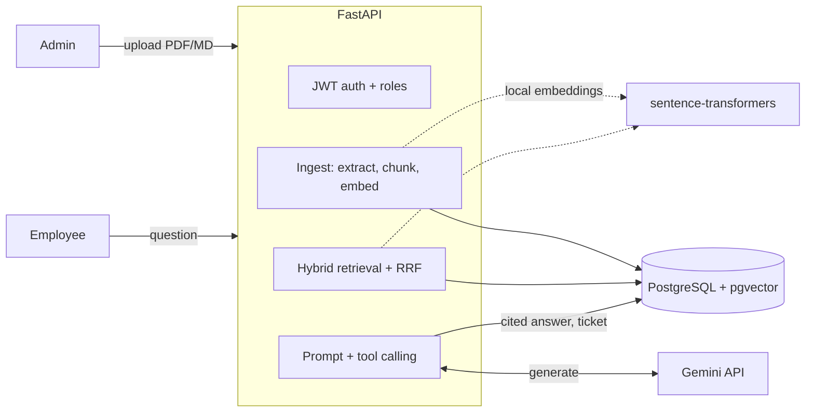

# IT Helpdesk Assistant (Multi-Tenant RAG)

A multi-tenant IT helpdesk assistant. An organization's admin uploads policy and runbook documents; employees ask questions and get **streamed answers with citations** pointing to the exact source chunks. When the documents don't cover a question, the assistant says so and **files a ticket itself** through an LLM tool call instead of guessing.

Built with FastAPI, PostgreSQL + pgvector, and Gemini. The RAG pipeline (chunk, embed, store, retrieve, prompt) is written by hand, with no LangChain or LlamaIndex, and ships with an evaluation harness for measuring retrieval and answer quality.

## Features

- **Multi-tenant by design:** every table carries `org_id`, every query filters on it, and `org_id` comes from the signed JWT, never from request input. An automated test checks that no retrieval mode leaks across organizations.
- **Role-based access:** `admin` (upload documents, manage users, view logs) and `employee` (ask questions, see own tickets).
- **Document ingestion:** PDF, Markdown and text uploads are extracted, chunked, embedded and stored as a background job.
- **Hybrid retrieval:** pgvector cosine search plus Postgres full-text search, merged with reciprocal rank fusion (RRF).
- **Cited answers:** the prompt requires `[C<id>]` citations, and only chunk ids that were actually retrieved are returned as citations.
- **Tool calling:** a `create_ticket(title, category, priority)` tool with Pydantic-validated arguments, retry on malformed output, and a safe fallback.
- **Streaming:** answers stream over Server-Sent Events (SSE).
- **Observability:** every request logs retrieved chunk ids, latency, token counts, and whether it was answered or ticketed.
- **Evaluation harness:** hit@k, MRR, refusal accuracy and optional LLM-judged faithfulness, swept across chunk sizes and retrieval modes.
- **Provider-agnostic LLM layer:** a small protocol in `app/llm.py`; Gemini is the first implementation.

## Architecture



**Chat request flow:** authenticate, embed the question locally, run vector and keyword search (both filtered by `org_id`), fuse with RRF, build a prompt from the top chunks, stream the model's answer, validate any `create_ticket` call, then log the request.

## Tech stack

| Layer | Choice |
|---|---|
| API | FastAPI, Pydantic, JWT (PyJWT), bcrypt |
| Database | PostgreSQL 16 with pgvector (HNSW index) and a generated `tsvector` column for full-text search |
| Embeddings | `all-MiniLM-L6-v2` via sentence-transformers (local, 384 dimensions, no rate limits) |
| LLM | Gemini through the `google-genai` SDK |
| Packaging | Docker Compose (one container for the API, one for Postgres) |

## Getting started

**Prerequisites:** Docker Desktop and a free Gemini API key from [Google AI Studio](https://aistudio.google.com).

```bash
git clone https://github.com/pratiyadav/helpdesk-assistant.git
cd helpdesk-assistant
cp .env.example .env          # Windows PowerShell: copy .env.example .env
```

Edit `.env`: set `GEMINI_API_KEY`, and set `JWT_SECRET` to a random string:

```bash
python -c "import secrets; print(secrets.token_hex(32))"
```

Start everything (the first build takes a while because it downloads PyTorch and the embedding model):

```bash
docker compose up --build
```

When you see `Application startup complete`, open **http://localhost:8000/docs** for the interactive API.

### Try it

The easiest way is the Swagger UI at `/docs`:

1. `POST /auth/register-org` creates an organization and its admin. Copy the returned `access_token`.
2. Click **Authorize** and paste the token.
3. `POST /documents` uploads files from `backend/sample_docs/`. Check `GET /documents` until each shows `ready`.
4. `POST /chat` with `{"question": "How do I reset my VPN token?"}` returns a cited, streamed answer.
5. Ask something the documents don't cover, such as `"What is the parental leave policy?"`, then check `GET /tickets`.

Or with `curl`:

```bash
# 1. create an org + admin
curl -s localhost:8000/auth/register-org -H 'content-type: application/json' \
  -d '{"org_name":"Acme","email":"admin@acme.com","password":"correct-horse-1"}'

# 2. upload a document (use the token from step 1)
curl -s localhost:8000/documents -H "Authorization: Bearer $TOKEN" -F file=@backend/sample_docs/vpn.md

# 3. ask a question (SSE stream)
curl -N localhost:8000/chat -H "Authorization: Bearer $TOKEN" -H 'content-type: application/json' \
  -d '{"question":"How do I reset my VPN token?"}'
```

### Configuration

| Variable | Purpose | Default |
|---|---|---|
| `JWT_SECRET` | Signs access tokens (required) | none |
| `GEMINI_API_KEY` | Gemini API key | none |
| `GEMINI_MODEL` | Model name; if the API returns 404, pick a model your key can access | `gemini-2.5-flash` |
| `CHUNK_SIZE` | Characters per chunk | `800` |
| `CHUNK_OVERLAP` | Characters of overlap between chunks | `100` |

`DATABASE_URL` is set by `docker-compose.yml`.

## API reference

| Method | Path | Access | Description |
|---|---|---|---|
| POST | `/auth/register-org` | public | Create an organization and its first admin |
| POST | `/auth/login` | public | Log in, returns a JWT |
| POST | `/users` | admin | Add an employee or admin to your organization |
| POST | `/documents` | admin | Upload a `.pdf`, `.md` or `.txt` file (ingested in the background) |
| GET | `/documents` | admin | List documents and their ingestion status |
| POST | `/chat` | any user | Ask a question; returns an SSE stream |
| GET | `/tickets` | any user | Admins see the organization's tickets; employees see their own |
| GET | `/logs` | admin | Recent requests with latency, tokens and retrieved chunk ids |

`/chat` streams JSON events: `token` (answer text), `citations` (source chunks), `ticket` (if one was filed) and `done` (with latency).

## Design decisions

- **One database for everything.** Users, tickets, vectors and logs live in PostgreSQL, so tenancy is a plain `WHERE org_id = ...`. A dedicated vector database scales further, but that is not needed at this size.
- **Hybrid retrieval.** Embeddings are weak at exact tokens such as error codes (`VPN-403`), while keyword search is weak at paraphrase. Fusing both rankings with RRF covers both without tuning score weights.
- **Local embeddings.** No rate limits and no cost during bulk ingestion; the trade-off is a larger Docker image.
- **No agent framework.** The `create_ticket` tool is validated with Pydantic and retried on invalid output. The whole pipeline is plain Python so that every failure can be traced.
- **Prompt-injection stance.** Retrieved excerpts are treated as data, and the system prompt tells the model to ignore instructions found inside them. This is a mitigation, not a guarantee.
- **Tenancy at the query layer.** Isolation depends on every query including `org_id`. Postgres row-level security would add a second layer and is on the roadmap.

## Evaluation

The harness in `backend/eval/` builds a temporary organization from `backend/sample_docs/`, runs the golden set against it, prints a table, and deletes the organization.

```bash
# Retrieval only: no LLM calls, fast and free
docker compose exec api python -m eval.run_eval --chunk-sizes 400,800,1200 --modes vector,keyword,hybrid

# Generation: refusal accuracy and LLM-judged faithfulness (uses Gemini calls)
docker compose exec api python -m eval.run_eval --chunk-sizes 800 --modes hybrid --full --judge

# Copy the results file out of the container
docker compose cp api:/app/eval/results.md ./results.md
```

**Data.** 18 synthetic IT-policy documents written for a fictional company (`backend/sample_docs/`) and a 48-question golden set (`backend/eval/golden_set.jsonl`): 38 answerable questions, each with a `gold_snippet` that must appear in a retrieved chunk, and 10 unanswerable questions used to test refusals.

**Metrics.**
- **hit@5:** the share of answerable questions where a chunk containing the gold snippet was in the top 5.
- **MRR:** the mean of 1/rank of the first chunk containing the gold snippet (1.0 means always first).
- **Refusal accuracy:** whether the assistant filed a ticket on exactly the unanswerable questions.
- **Faithfulness:** an LLM judge checks whether the answer is supported by the cited chunks. A model grading a model is noisy and can be biased toward its own family, so treat it as a rough signal.

### Retrieval results

| Chunk size | Mode | hit@5 | MRR |
|---|---|---|---|
| 400 | vector | 1.00 | 0.92 |
| 400 | keyword | 1.00 | 0.86 |
| 400 | hybrid | 1.00 | 0.94 |
| 800 | vector | 1.00 | 0.95 |
| 800 | keyword | 1.00 | 0.93 |
| 800 | hybrid | 1.00 | 0.95 |
| 1200 | vector | 1.00 | 0.95 |
| 1200 | keyword | 1.00 | 0.93 |
| 1200 | hybrid | 1.00 | 0.95 |

**How to read this.** hit@5 is 1.00 in every configuration, so this set cannot tell the retrieval modes apart on recall. Hybrid retrieval ranked the right chunk slightly higher at 400 characters (MRR 0.94 vs 0.92) and tied vector search at 800 and 1200, but a 0.02 gap is within noise: keyword MRR itself moved by about 0.01 between two runs. With only 18 short documents the corpus is easy.

### Limitations and next evaluation steps

- The corpus and the questions are synthetic and small. Harder questions (paraphrases, near-duplicate documents, exact codes buried in long runbooks) and a larger document set are needed before concluding that hybrid retrieval helps.
- Refusal accuracy and faithfulness are implemented in the harness but **not yet measured**, so no numbers are reported here.
- Gold snippets are matched by string, so a gold fact split across a chunk boundary counts as a miss; snippets were checked to survive chunking at all three sizes.

## Testing

```bash
docker compose exec api pytest -q
```

`tests/test_tenancy.py` creates two organizations with distinct content and asserts that vector, keyword and hybrid retrieval never return the other organization's chunks.

## Project structure

```
.
├── docker-compose.yml
├── .env.example
└── backend/
    ├── Dockerfile
    ├── requirements.txt
    ├── app/
    │   ├── main.py         # routes, SSE endpoint, lifespan
    │   ├── auth.py         # JWT, password hashing, role checks
    │   ├── db.py           # connection pool, schema init
    │   ├── schema.sql      # tables, HNSW + GIN indexes
    │   ├── ingest.py       # text extraction, chunking, embedding, storage
    │   ├── embeddings.py   # local sentence-transformers model
    │   ├── retrieval.py    # vector, keyword, RRF fusion
    │   ├── rag.py          # prompt, tool calling, validation, logging
    │   └── llm.py          # provider protocol + Gemini implementation
    ├── eval/
    │   ├── run_eval.py     # evaluation harness
    │   ├── golden_set.jsonl
    │   └── make_golden.py  # generator for the golden set
    ├── sample_docs/        # 18 synthetic IT documents
    └── tests/
        └── test_tenancy.py
```

## Known limitations

- Ingestion runs as an in-process background task, not a durable job queue, so a server restart can leave a document stuck in `processing`.
- Chunking is character-based with a paragraph/sentence preference; it is not layout-aware, so tables in PDFs extract poorly.
- The HNSW index is approximate and combined with an `org_id` filter; this is fine at small scale but should be re-checked as tenants grow.
- Tenant isolation relies on application-level filtering; row-level security is not enabled yet.
- No frontend yet; the API is used through Swagger UI or `curl`.

## Roadmap

- Next.js chat UI with a citation side panel, admin upload page and ticket list
- Postgres row-level security as a second isolation layer
- Larger, harder evaluation set; run and report refusal accuracy and faithfulness
- A second LLM provider behind the existing interface
- Cloud deployment (managed Postgres with pgvector, containerized API)